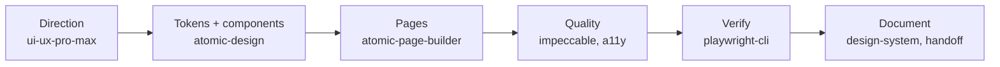

<div align="center">

# claude-toolkit

**Control center for my Claude setup: own skills, plugins, connectors and MCP servers, versioned and documented.**


</div>

## Overview

- **Own skills**, grouped by domain as Claude Code plugins and installable from this repo.
- **A catalog of everything else** I use (Anthropic plugins, third-party tools, connectors, MCP
  servers): what each does, how to install it and what it pairs with.
- **One place to audit** the setup, so nothing is duplicated, forgotten or out of date.

## Quick start

```
/plugin marketplace add <path-or-github-user>/claude-toolkit
/plugin install design-kit@claude-toolkit
/plugin install dev-workflow@claude-toolkit
```

Needs Claude Code, Node.js, Git and Python (`python` on Windows). More in
[Getting started](docs/getting-started.md).

## Documentation

| | Guide | What you will find |
|:-:|---|---|
|  | [Getting started](docs/getting-started.md) | Requirements, install, repository layout |
|  | [design-kit](docs/design-kit.md) | My plugin: `atomic-design` and `atomic-page-builder`, files, rules, sources |
|  | [dev-workflow](docs/dev-workflow.md) | My plugin: `task-closure`, verify-for-real habits and the ready commit command |
|  | [Anthropic plugins](docs/anthropic-plugins.md) | Engineering, Design, Skill Creator, Firebase, Playwright, LinkedIn |
|  | [Design tools](docs/design-tools.md) | Impeccable, UI/UX Pro Max, Playwright CLI and standalone UI skills |
|  | [Connectors and MCP](docs/connectors-and-mcp.md) | Enabled connectors, Firebase MCP, Android Studio MCP setup |
|  | [Design workflow](docs/design-workflow.md) | How the pieces work together, step by step |
|  | [Contributing](docs/contributing.md) | Adding a skill, licenses, maintenance |

## Catalog

| | Item | Origin | Kind | Install | Details |
|:-:|---|---|---|---|---|
|  | **design-kit** | Own (MIT / AID sources) | Plugin, 2 skills | This marketplace | [docs](docs/design-kit.md) |
|  | **dev-workflow** | Own | Plugin, 1 skill | This marketplace | [docs](docs/dev-workflow.md) |
|  | Engineering | Anthropic | Plugin, 10 skills | claude.ai directory | [docs](docs/anthropic-plugins.md#engineering-v120-10-skills) |
|  | Design | Anthropic | Plugin, 7 skills | claude.ai directory | [docs](docs/anthropic-plugins.md#design-v120-7-skills) |
|  | Skill Creator | Anthropic | Plugin, 1 skill | claude.ai directory | [docs](docs/anthropic-plugins.md#skill-creator) |
|  | Firebase | Google | Plugin, MCP server | GitHub marketplace | [docs](docs/connectors-and-mcp.md#firebase-mcp-server-claude-code) |
|  | Playwright | Anthropic directory | Plugin, MCP server | claude.ai directory | [docs](docs/anthropic-plugins.md#playwright-mcp-server) |
|  | LinkedIn Review and Resume | Anthropic directory | Plugin, MCP server | claude.ai directory | [docs](docs/anthropic-plugins.md#linkedin-profile-review--resume-converter-mcp-server) |
|  | Impeccable | pbakaus | Plugin | GitHub marketplace | [docs](docs/design-tools.md#impeccable) |
|  | UI/UX Pro Max | nextlevelbuilder | Plugin and data | GitHub marketplace | [docs](docs/design-tools.md#uiux-pro-max) |
|  | Playwright CLI | Microsoft | CLI and skill | npm | [docs](docs/design-tools.md#playwright-cli) |
|  | UI Skills set | UI Skills registry | Standalone skills | `npx ui-skills` | [docs](docs/design-tools.md#standalone-ui-skills) |
|  | Connectors (4) | Various | claude.ai connectors | claude.ai settings | [docs](docs/connectors-and-mcp.md#connectors) |

## Design workflow



Full detail in [Design workflow](docs/design-workflow.md).

## Layout

```
.claude-plugin/marketplace.json   Plugin list (installs with /plugin install)
plugins/<plugin>/                 My plugins: skills, references, assets, NOTICE.md
docs/                             Detailed guides linked above
scripts/check.py                  Repository self-check (also runs in CI)
.github/workflows/check.yml       Runs the self-check on every push and pull request
```

## Licenses

Own work plus material derived from MIT and AID Community License sources. Details and
attribution in [plugins/design-kit/NOTICE.md](plugins/design-kit/NOTICE.md). No secrets in this repo.
