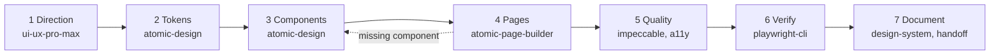

# Design workflow

[← README](../README.md) · [Getting started](getting-started.md) · [design-kit](design-kit.md) · [dev-workflow](dev-workflow.md) · [Anthropic plugins](anthropic-plugins.md) · [Design tools](design-tools.md) · [Connectors & MCP](connectors-and-mcp.md) · [Design workflow](design-workflow.md) · [Contributing](contributing.md)

---



Typical frontend flow, with the tool for each step:

```
1 Direction     ui-ux-pro-max        style, palette, typography, UX guidelines
2 Tokens        atomic-design        assets/tokens.css from the chosen direction
3 Components    atomic-design        atoms -> molecules -> organisms, rules N D P S T A R Q
4 Pages         atomic-page-builder  compose from existing components; gaps go back to step 3
5 Quality       impeccable, fixing-accessibility, baseline-ui, fixing-motion-performance
6 Verify        playwright-cli       375/768/1440px, light and dark, console clean
7 Document      design:design-system, create-design-md, design:design-handoff
```

Wrap every task, in any step, with `dev-workflow:task-closure`: understand first, verify for
real, then close with a fixed report and a ready commit command (see
[dev-workflow](dev-workflow.md)).

Cross-cutting: `engineering:testing-strategy` for tests, `engineering:code-review` before merge,
`engineering:architecture` for ADRs, `skill-creator` when authoring or tuning any skill here.

---

[← README](../README.md) · [Getting started](getting-started.md) · [design-kit](design-kit.md) · [dev-workflow](dev-workflow.md) · [Anthropic plugins](anthropic-plugins.md) · [Design tools](design-tools.md) · [Connectors & MCP](connectors-and-mcp.md) · [Design workflow](design-workflow.md) · [Contributing](contributing.md)
